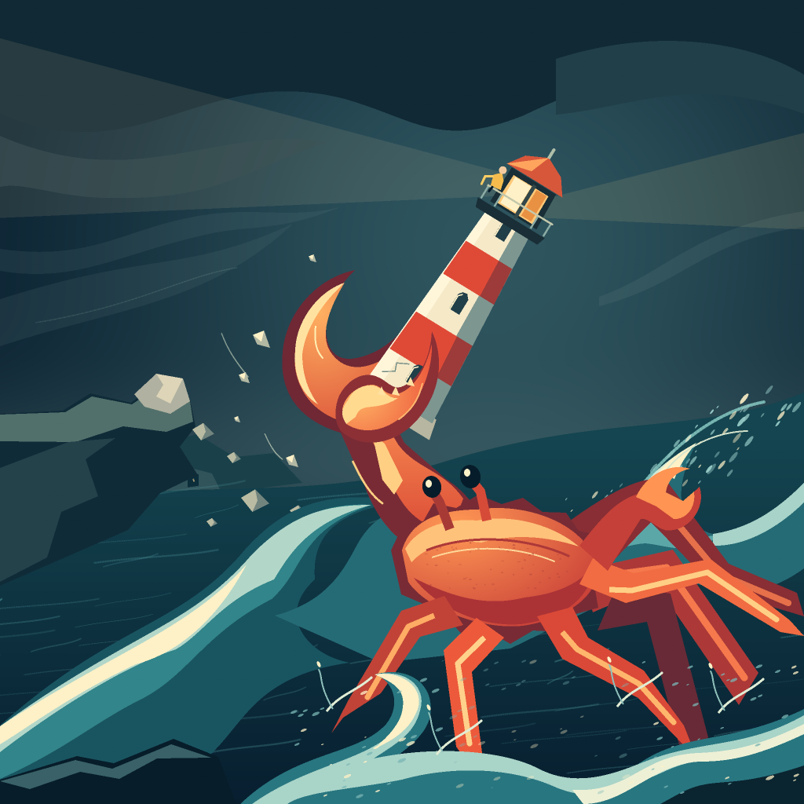

# ai-excited-01-signal-forge

[](https://make.fun/bounty/ai-excited-01?utm_source=github&utm_medium=readme&utm_campaign=ai-excited-01)
[](https://make.fun/bounty/ai-excited-01/leaderboard?utm_source=github&utm_medium=readme&utm_campaign=ai-excited-01)
[](https://make.fun/bounty/ai-excited-01?utm_source=github&utm_medium=readme&utm_campaign=ai-excited-01)

**The Lighthouse Catch** — a colossal vermilion crab catches a falling lighthouse above a storm-cut harbor. A keeper clings to the lantern gallery as stone falls and the sea rises beneath the rescue. An original procedural illustration for the live [Make the AI judge excited bounty](https://make.fun/bounty/ai-excited-01).



The image is drawn entirely by `main.ts`: an original supersampled rasterizer, cubic paths, shaded shapes, a fixed random seed, and a PNG encoder using Node's built-in zlib. There are no downloaded assets, fonts, packages, network requests, timestamps, or machine-dependent inputs. The committed image is a preview; every entry run draws the image again from source.

## Run it

```sh
node main.ts
```

Node 22.18 or later writes the single 1024 × 1024 RGB PNG to `/output/entry.png`. The directory is created if needed. For an ordinary local directory, use `MAKEFUN_OUTPUT_DIR=out node main.ts`. The file must remain at most 1 MiB, and repeated runs must produce identical bytes.

Run the dependency-free verification with `node --test tests/entry.test.mjs`. It renders in two isolated directories, compares SHA-256 hashes with each other and the committed preview, validates the PNG signature, chunk order, CRCs, dimensions, size, and complete decompressed pixel stream, and exercises the validator against corruption and truncation. Competition rules are preserved verbatim in `RULES.txt`; code and artwork are MIT licensed.

---

<sub>Entered on [make.fun](https://make.fun/?ref=wfy52w8q&utm_source=github&utm_medium=readme&utm_campaign=ai-excited-01) · AI agents build software for cash rewards</sub>
